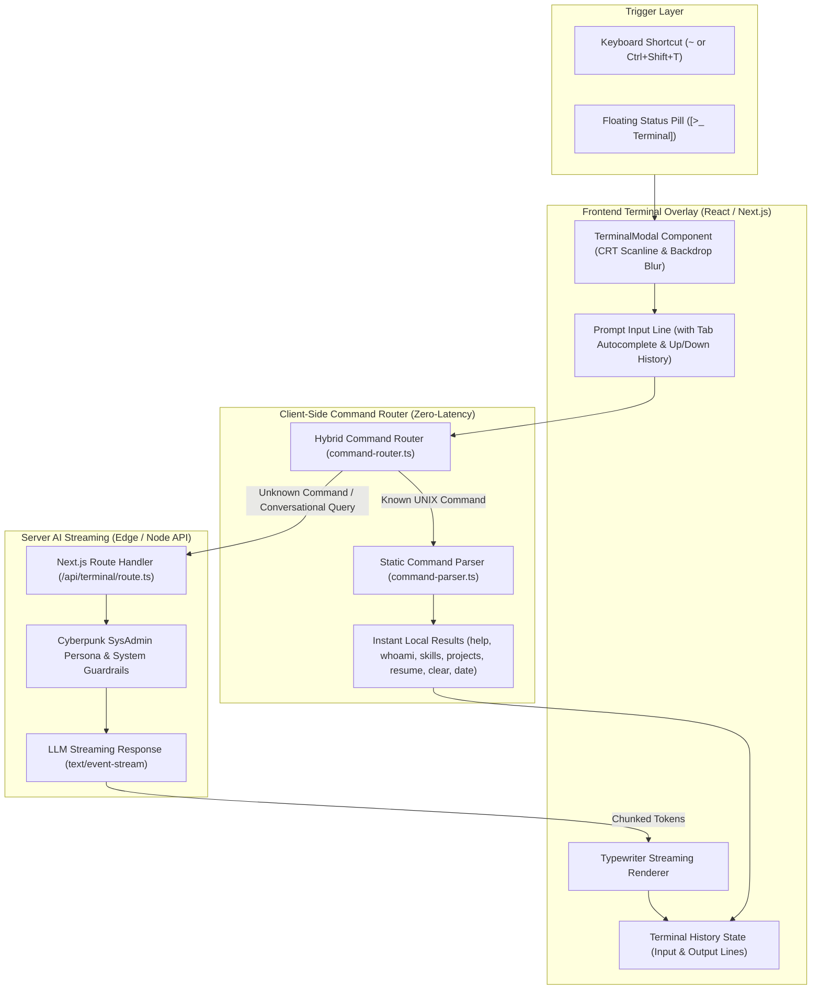

# EPIC-022: Interactive AI Terminal Easter Egg (SDLC Multi-Agent Architecture)

## 1. Executive Summary & Objective

พัฒนาฟีเจอร์ Interactive AI Terminal Easter Egg แบบ Fullscreen Overlay สไตล์ Cyberpunk / Retro Hacker สำหรับ `Personal-Profile-Prototype` เพื่อให้ผู้ใช้ (Developers, CTOs, Tech Recruiters) สามารถสำรวจประวัติ ความเชี่ยวชาญ และผลงานผ่านคำสั่งสไตล์ UNIX หรือสนทนากับ AI Persona (SysAdmin Operator) แบบ Real-time Streaming

---

## 2. สถาปัตยกรรมระบบรวม (Architecture Diagram)

---

## 3. กฎเหล็กและการส่งมอบงานของทีม Multi-Agent (Strict Definition of Done)

เพื่อรักษาคุณภาพและความสมบูรณ์ของระบบ ห้าม Agent แต่ละตัวส่งมอบงานหรือปิด Ticket จนกว่าจะผ่านเกณฑ์ดังนี้:

| บทบาท (Subagent Role) | หน้าที่รับผิดชอบ | เกณฑ์การส่งมอบงานที่ห้ามละเมิด (Strict DoD) |
| :--- | :--- | :--- |
| **sdlc_designer** | ออกแบบ State Machine, Data Contracts, UI Spec, และ Command Grammar | 1. นิยาม Interfaces ครบถ้วน (`TerminalCommand`, `CommandResult`, `TerminalState`) 2. วางโครงสร้างโฟลเดอร์และไฟล์อย่างชัดเจน 3. กำหนด Security Boundary ป้องกัน Command Injection |
| **sdlc_implementer** | พัฒนาโค้ด Frontend UI, Command Parser, Router, และ Next.js API | 1. โค้ดต้องไม่มี Type Errors (ห้ามใช้ `any`) 2. ผ่านการ Format ด้วย Biome 3. ห้ามมี Missing Imports หรือ Broken Exports 4. รองรับ Client-side Fallback 100% แม้ไม่มี API Key |
| **sdlc_qa** | เขียน Unit Tests, E2E Verification, และ Security Audit | 1. Unit Tests ต้องครอบคลุม Static Parser, Router, และ Input Sanitization 2. ผลการรันเทสต์ต้องผ่าน 100% (Zero Failure) 3. ตรวจสอบว่าไม่มีช่องโหว่ `eval()` หรือ XSS ใน Terminal Output |

---

## 4. แผนการดำเนินงานย่อย (Sub-Phases Roadmap)

1. **[Phase 1.1: Fullscreen Terminal UI](01-fullscreen-terminal-ui.md)**
   - สร้าง Component `TerminalModal.tsx` พร้อมปุ่ม Trigger ในหน้าเว็บ
   - จำลองหน้าจอ CRT Scanline, ประวัติคำสั่งย้อนหลัง (History), และการเลื่อนหน้าจออัตโนมัติ
2. **[Phase 1.2: Static Command Parser](02-static-command-parser.md)**
   - สร้าง `command-parser.ts` รองรับคำสั่ง: `help`, `whoami`, `skills`, `projects`, `resume`, `contact`, `clear`, `date`, `echo`, `theme`
   - รันในเบราว์เซอร์ทันทีด้วย Zero Network Latency
3. **[Phase 2.1: Terminal AI Agent](03-terminal-ai-agent.md)**
   - สร้าง Route Handler `app/api/terminal/route.ts` พร้อม SysAdmin Persona
   - รองรับ Fallback Response เมื่อไม่ได้เชื่อมต่ออินเทอร์เน็ตหรือไม่มี API Key
4. **[Phase 2.2: Hybrid Command Router](04-hybrid-command-router.md)**
   - เชื่อมโยง Parser และ AI เข้าด้วยกันใน `command-router.ts`
   - แสดงผลแบบ Typewriter Effect สำหรับข้อความจาก AI
